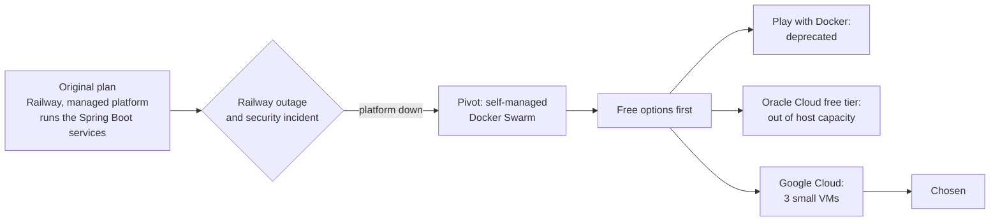
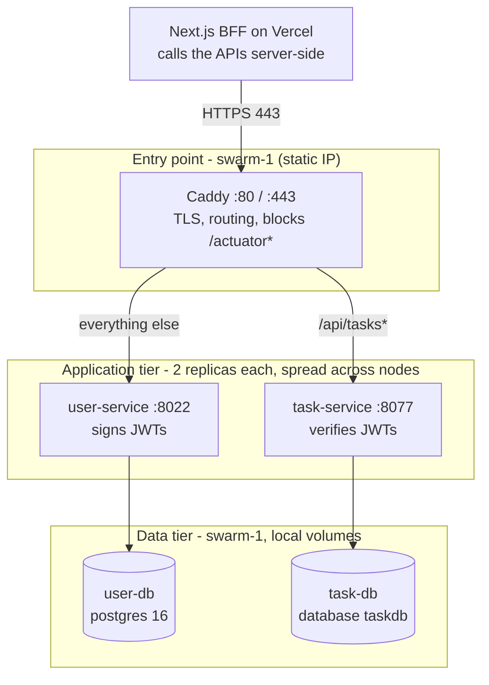
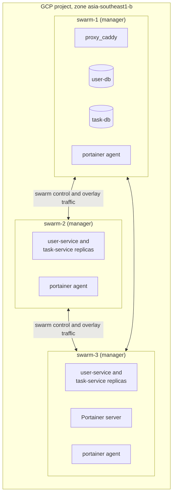
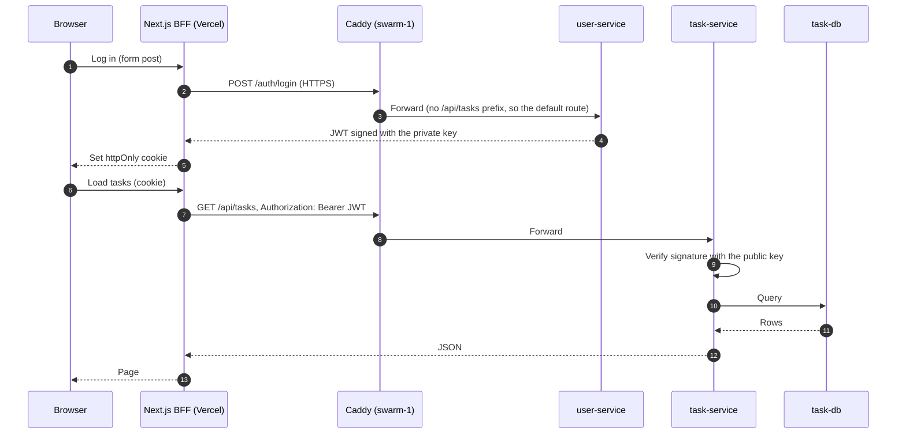
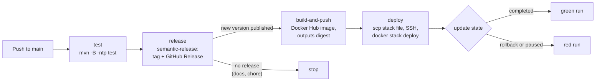
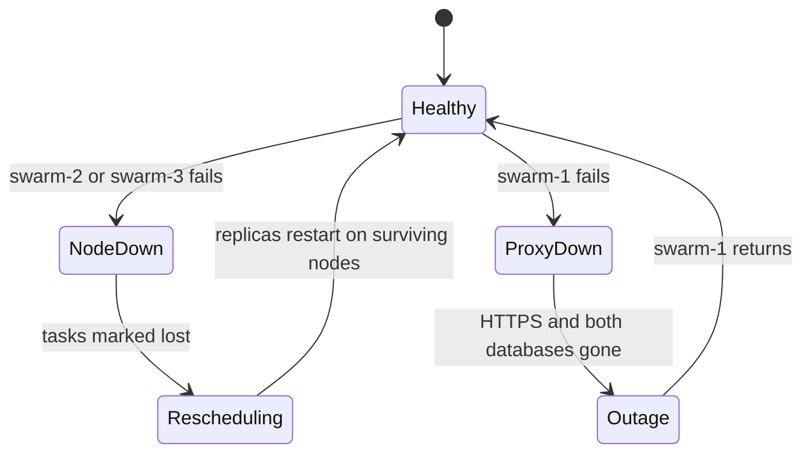

# Docker Swarm on Google Cloud: Setup, Motivation and Design Decisions

This document explains why the Users and Tasks APIs run on a three-node Docker Swarm on Google Cloud (GCP), how the setup is built, and why each design choice was made. For day-to-day commands (deploys, failover drill, teardown) see the [architecture and runbook](README-runbook.md) document.

## 1. Summary

| | |
|---|---|
| Workload | Two Spring Boot APIs: Users (signs JWTs, port 8022) and Tasks (verifies JWTs, port 8077), each with its own PostgreSQL 16 database |
| Platform | Docker Swarm on three GCP Compute Engine VMs (`swarm-1`, `swarm-2`, `swarm-3`), type `e2-medium` (2 vCPU, 4 GB), Ubuntu 24.04, zone `asia-southeast1-b` |
| Public entry | `https://sctp-aie-m4-apigw.work.gd`, served by Caddy on `swarm-1` (static IP) |
| Delivery | GitHub Actions: test, semantic-release, build and push to Docker Hub, deploy over SSH with a rolling update |
| Consumer | A Next.js frontend with a backend-for-frontend (BFF) layer on Vercel, outside the swarm |
| Goal | Demonstrate a highly available application tier on a small budget: if a node dies, its replicas restart on the others |

## 2. Motivation

### 2.1 What the project is about

The project is about **DevOps, containerization and CI/CD**: packaging an application into container images, shipping those images through an automated pipeline, and running them reliably. These practices are easiest to show on a **microservice** system, where several independently built and released services have to be deployed, connected and updated without breaking each other. That is why the application is split into two services rather than one:

- **Users API:** handles login and signs JWTs.
- **Tasks API:** serves task data and only verifies the JWTs.

Each service has its own codebase, container image, database, pipeline and release cycle. A change to one is built, tested, versioned and deployed without touching the other, which is the point a single monolith could not make. Docker Swarm was chosen as the orchestrator because it runs those containers as replicated services across several machines with little setup (see 2.4).

### 2.2 What the setup has to prove

The deployment must be something a reviewer can inspect and break on purpose:

- **Containerization:** each service builds into its own image and runs identically on every node.
- **CI/CD:** a push to `main` runs tests, assigns a version, builds and pushes the image, and deploys it with no manual steps.
- **Replication and self-healing:** more than one copy of each API; stop a node and watch the lost replicas reappear elsewhere.
- **Zero-downtime releases:** a rolling update, with automatic rollback on a bad image.
- **Realistic security:** HTTPS, no database or admin ports on the internet, secrets outside Git.

It does not need to be a permanent production system, so a short-lived, low-cost environment was acceptable.

### 2.3 How the platform was chosen

The original plan was to deploy on **Railway** and have the platform run the Spring Boot services, which would have kept the infrastructure work small. That plan ended when Railway had an outage and a security incident and its service was down, so the project could not rely on it. The deployment pivoted to **Google Cloud (GCP) with Docker Swarm**, which also exposes the orchestration and networking layers that a managed platform hides. That is a better fit for a project about DevOps.

Cost was still the main constraint, so free options were tried before GCP. Each failed for a practical reason:

| Option | Outcome |
|---|---|
| Railway (original plan) | Abandoned: an outage and a security incident left the platform down |
| Play with Docker | Rejected: the service has been deprecated |
| Oracle Cloud (OCI) free tier | Attempted: VM creation failed with `500-InternalError, Out of host capacity`, so no free ARM instances could be created |
| Google Cloud | Chosen: three small VMs paid for by the GCP free trial (US$300 of credit, valid for 90 days), enough for a three-node cluster |

The GCP free trial gives new accounts US$300 of credit that must be used within 90 days. That is more than a three-VM demo needs, so the environment costs nothing out of pocket as long as it is built and torn down inside that window. Signing up needs a billing account (and may ask for a payment method or prepayment), and usage beyond the credit, or after the 90 days, is billed normally.

Three VMs matter more than their size. A Swarm manager quorum needs a majority of managers alive, so a three-node cluster is the smallest layout that survives losing one node.

### 2.4 Why Swarm and not Kubernetes

| Factor | Docker Swarm | Kubernetes |
|---|---|---|
| Starting point | Existing `docker-compose.yml` files convert to stack files with small edits | Needs new manifests or Helm charts |
| Footprint | Built into Docker; fits on 4 GB VMs with room for the apps | Control plane alone uses a large share of a 4 GB node |
| Concepts to learn | Services, stacks, overlay networks, secrets | Many more objects |
| Needed features | Replicas, rolling updates, health checks, rollback, secrets, placement | Same, plus far more than this project needs |

Swarm gives every property the project needs with the least machinery. The trade-off is a smaller ecosystem and no built-in autoscaling.

## 3. Architecture

### 3.1 Where things run

Only three things are pinned to a node; everything else floats and Swarm balances it.

| Pinned item | Node | Reason |
|---|---|---|
| `user-db`, `task-db` | `swarm-1` (label `db=true`) | Their data lives in a local volume on that node's disk |
| `proxy_caddy` | `swarm-1` (hostname constraint) | The DNS name points at this node's static IP; certificates are stored on its disk |
| Portainer server | `swarm-3` | Keeps the dashboard off `swarm-1`, which already carries the databases and proxy |

All three nodes are intended to be managers so the cluster keeps quorum when one is lost. This should be confirmed with `docker node ls`.

### 3.2 Request path

The browser only ever talks to Vercel, so the APIs need no CORS configuration, and the token is never readable by browser JavaScript.

### 3.3 The roles of Caddy and Portainer

| | Caddy | Portainer |
|---|---|---|
| Purpose | The public front door: HTTPS, routing and protection for both APIs | A dashboard for the administrator to observe and operate the swarm |
| Audience | Every client request | The administrator only |
| Exposure | Public, ports 80 and 443 | Private: SSH tunnel to port 9443 |
| Why it is in the design | One hostname, free automatic certificates, hidden actuator, APIs stay off the internet (D3) | A visual view of replicas and failover for demonstration, without opening another port (D10) |
| Required? | Yes, for public HTTPS | No, it is a convenience |

## 4. Design decisions

Each decision lists the choice, the reason, and what it costs.

### D1. Three nodes, all managers

- **Choice:** three VMs, all in the manager role.
- **Why:** Swarm uses Raft consensus, which needs a majority. With three managers one can fail and the cluster still accepts changes. With one or two managers, losing one node loses the control plane.
- **Cost:** managers also run workloads here, so a small VM carries both jobs. Acceptable at this scale.

### D2. One stack per concern

- **Choice:** four stacks: `users`, `tasks`, `proxy`, `portainer`.
- **Why:** each stack deploys and rolls back independently, so a Tasks release never restarts the Users service. Each API stack owns its own overlay network, which keeps the two applications isolated from one another.
- **Cost:** Caddy must join both application networks, declared as external networks (`users_users-network`, `tasks_tasks-network`) in the proxy stack. Stack names must match the file or stray services appear (a past mistake produced `users_task-service`).

### D3. A reverse proxy as the only door

- **Choice:** Caddy 2 publishes ports 80 and 443 in host mode on `swarm-1`. The application ports (8022, 8077) are not published.
- **Why:**
  - Caddy gets and renews free Let's Encrypt certificates on its own.
  - One public hostname serves both APIs, split by path.
  - It can hide endpoints. `/actuator*` returns 404 publicly, while the container health check still reaches it on `localhost`.
  - Host mode keeps the real client IP visible to Caddy and opens the port only on the node that runs it. Ingress mode would open the port on every node.
- **Cost:** one Caddy replica on one node is a single point of failure for HTTPS (see section 6).
- **Detail to remember:** Caddy runs `handle` blocks in written order and the first match wins, so the actuator block comes first. Swarm configs are immutable, so a changed Caddyfile needs a new config name.

### D4. Databases pinned, not replicated

- **Choice:** each database is one replica, pinned to `swarm-1` with a node label, on a local named volume.
- **Why:** Postgres replication is a separate engineering problem, and Swarm has no shared storage. A local volume only works if the container always returns to the same node, so the container is pinned to it.
- **Cost:** the data tier does not survive losing `swarm-1`. The project demonstrates availability of the application tier only. Section 6 lists the ways to remove this limit.

### D5. JWT keys as Swarm secrets, split by role

- **Choice:** an asymmetric key pair. The private key is mounted only into `user-service`; the public key only into `task-service`.
- **Why:** the Tasks API only needs to verify tokens, so it never holds anything that can mint them. A compromise of the Tasks API cannot forge logins. Secrets are mounted as files under `/run/secrets`, not passed as environment variables.
- **Cost:** Swarm secrets are immutable. To rotate a key, give the secret a new name (for example `jwt_private_key_v2`) in the stack file. Production keys must be a fresh pair, not the development ones.

### D6. Health checks use the liveness endpoint

- **Choice:** the container health check calls `/actuator/health/liveness` on `localhost`, with a 90 second start period.
- **Why:** Swarm only counts a replica as healthy once the check passes, which is what makes a rolling update safe. Liveness is used instead of the full `/actuator/health` because it ignores the database; a short Postgres outage then does not cause Swarm to kill healthy application containers.
- **Cost:** the application must expose the probe endpoints and permit them in Spring Security, otherwise every replica is reported unhealthy and every deploy rolls back.

### D7. Rolling updates with automatic rollback

- **Choice:** `order: start-first`, parallelism 1, a 30 second monitor period, `failure_action: rollback`.
- **Why:** start-first brings up the new replica before stopping the old one, so there is always a serving replica. A bad release fails its health check and reverts on its own.
- **Cost:** during an update a node briefly runs one extra container, which needs spare memory. Replicas have a 512 MB limit and the JVM heap is capped with `-XX:MaxRAMPercentage=70`.

### D8. Retry policy replaces `depends_on`

- **Choice:** `restart_policy: on-failure` with a 10 second delay and up to 10 attempts.
- **Why:** Swarm ignores `depends_on`. If an API starts before its database is ready it exits, and the restart policy retries until Postgres accepts connections.

### D9. Immutable image references

- **Choice:** the deploy job sets `IMAGE_TAG` to `version@sha256:digest`.
- **Why:** the version tag is readable, and the digest guarantees every node pulls the exact image that CI built, even if a tag is later moved. Tags also include the commit SHA for traceability.
- **Cost:** hand deploys must reuse the running image reference (read from `docker service inspect`), or the tag is left blank and the deploy fails.

### D10. Admin access only through SSH tunnels

- **Choice:** no firewall rule opens a database port (5422, 5477) or Portainer (9443). DBeaver and Portainer are reached through `ssh -L` tunnels.
- **Why:** both are powerful interfaces: one reads data, the other controls the Docker socket. Putting them behind SSH reuses an authentication path that already exists and removes two attack surfaces.
- **Cost:** a tunnel must be open to use either one, and it has to be run on the machine whose browser or client will use it. The database tunnel needs a host-mode published port on `swarm-1`, which is added to the stack file only when needed.

### D11. Firewall: three public ports

| Port | Source | Rule | Purpose |
|---|---|---|---|
| TCP 22 | Internet | default SSH rule | Admin, CI deploys, tunnels |
| TCP 80, 443 | Internet | `swarm-web` | Caddy: HTTPS, certificate issuance, redirect |
| 2377/tcp, 7946/tcp+udp, 4789/udp | Other nodes | `default-allow-internal` | Swarm control and overlay traffic |

Port 80 must stay open, since Let's Encrypt validates the domain over it. The earlier rule that opened 8022 and 8077 was deleted once the proxy was in place.

### D12. Frontend stays outside the swarm

- **Choice:** the Next.js app and its BFF stay on Vercel.
- **Why:** it already works and deploys automatically; moving it would add load to small VMs for no benefit. The BFF calls the APIs from the server side and keeps the JWT in an httpOnly cookie.
- **Cost:** Caddy sees Vercel's IP addresses, not end users', so IP-based rate limiting at the proxy would affect all site users at once. If the swarm or Caddy is down, the site loads but its API calls fail.

### D13. A free domain name from DNSExit

- **Choice:** the hostname `sctp-aie-m4-apigw.work.gd` comes from [DNSExit](https://dnsexit.com/), which provides free domain names with DNS hosting.
- **Why:** Let's Encrypt only issues certificates for names, not bare IP addresses, so HTTPS needs a hostname. A free name keeps the project at no extra cost.
- **Alternatives:** DuckDNS, FreeDNS (afraid.org), No-IP, wildcard-DNS services such as sslip.io and nip.io (no sign-up, but certificate rate limits are shared), or a paid domain with Cloudflare DNS. The setup guide lists them with notes.
- **Cost:** a free domain depends on the provider's terms and can be withdrawn; a paid domain is the more durable choice if the project outlives the demo.

## 5. Delivery pipeline

Design points:

- **Gated stages:** each job needs the one before it, so a failing test builds nothing.
- **Versions from commit messages:** semantic-release reads conventional commits. `fix:` is a patch, `feat:` a minor, `feat!:` or a `BREAKING CHANGE:` footer a major. `docs:` and `chore:` produce no release, so no image is built and nothing deploys.
- **Deploy waits for the result:** the job polls the service's `UpdateStatus` and fails on a rollback, so a green run means the new replicas are healthy.
- **Serialised deploys:** a concurrency group stops two runs deploying one stack at once, and never cancels one halfway.
- **Stack file in Git is the source of truth:** the job copies it to `swarm-1` on every deploy, overwriting any hand edit on the server.
- **Secrets:** `DOCKER_USERNAME`, `DOCKER_TOKEN`, `SSH_PRIVATE_KEY`, `SSH_KNOWN_HOSTS`, `SSH_HOST` and `SSH_USER` per repository. The deploy key is dedicated to CI and is never reused for DBeaver. Pinning the host key in `SSH_KNOWN_HOSTS` stops the runner trusting an impostor server.
- **Reuse:** the two API repositories use the same workflow; only five values at the top of the file differ (image name, stack name, stack file, env file, service name).

## 6. Failure behaviour and known limits

| What fails | Result |
|---|---|
| `swarm-2` or `swarm-3` | Surviving replicas keep serving; Swarm starts replacements on the remaining nodes within seconds |
| `swarm-1` | The entry point and both databases go with it; the API replicas elsewhere are unreachable. This is the design's main limit |
| Bad release | Health check fails, Swarm rolls back, the CI job fails |
| Database briefly down | API replicas stay up (liveness ignores the database) and requests that need data fail until it returns |

Known limits and how to remove them:

| Limit | Fix |
|---|---|
| Databases pinned to one node and one disk | Managed Postgres with a free tier, or replicated Postgres such as Patroni |
| Single Caddy on one node, one DNS record | More than one proxy node behind a load balancer or several DNS records |
| No backups | Scheduled `pg_dump` copied off the VM |
| `ddl-auto=create` if still set | Use `update`, or a migration tool, so a restart does not wipe tables |
| Env files and JWT keys exist only on `swarm-1` | Copy them to the other managers, or move every value into Swarm secrets |
| Port 22 open to the internet | Key-only login (the GCP default), a dedicated deploy key, and branch protection on `main` |
| Caddy can be called by anyone, not only the BFF | Optional shared-secret header that Caddy checks |

## 7. Operating cost and cleanup

The environment runs on the GCP free trial: US$300 of credit, valid for 90 days from sign-up. Check the remaining credit and the expiry date under Billing in the console, and delete the environment before the trial ends so nothing is charged afterwards.

Cost comes from three VMs, their disks, and the reserved static IP, which GCP bills when it is not attached to a running VM. To stop all charges: remove the stacks, delete the VMs and the `swarm-web` rule, release the static IP, and check Disks and IP addresses in the console for leftovers. Keep the stack files, the Caddyfile and the workflows in Git so the environment can be rebuilt from the documentation.

## 8. Decision summary

| # | Decision | Main benefit | Main trade-off |
|---|---|---|---|
| D1 | Three managers | Survives one node loss | Managers also run workloads |
| D2 | One stack per concern | Independent deploys, isolated networks | Cross-stack networking for Caddy |
| D3 | Caddy as the only door | Free TLS, one hostname, hidden actuator | Single proxy node |
| D4 | Databases pinned | Simple, no shared storage needed | Data tier not highly available |
| D5 | Split JWT keys | Tasks API cannot mint tokens | Immutable secrets, rotate by renaming |
| D6 | Liveness health check | Safe rollouts, no restart on DB blips | Needs actuator setup |
| D7 | Start-first updates with rollback | No downtime, self-reverting | Needs spare memory |
| D8 | Restart policy over `depends_on` | Works with start order races | A few failed starts at boot |
| D9 | Image digest references | Exact, repeatable deploys | Slightly longer image strings |
| D10 | SSH tunnels for admin | No extra public ports | Tunnel needed each time |
| D11 | Three public ports | Small attack surface | Port 22 still public |
| D12 | Frontend on Vercel | Already working, no VM load | Caddy sees Vercel IPs only |
| D13 | Free DNSExit domain | HTTPS at no cost | Depends on the provider's terms |