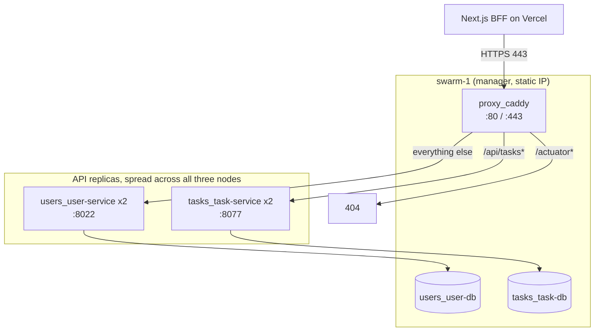
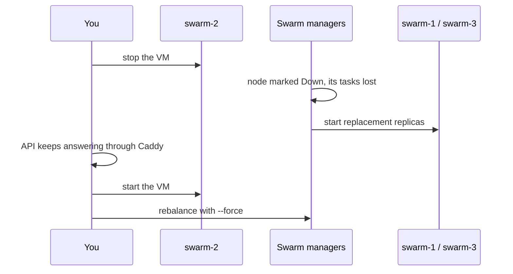

# Docker Swarm on Google Cloud: Architecture and Runbook

Day-to-day operation of the Users and Tasks APIs on the three-node swarm: what runs where, how to deploy, roll back, run the failover drill, change configuration and tear down. Why the environment looks this way is in the [design and motivation document](README-design.md), and how to build it from nothing is in the [setup guide](README.md).

Commands marked **swarm-1** run over SSH on that VM (`gcloud compute ssh swarm-1 --zone=asia-southeast1-b`). Commands marked **local** run on your own computer with the `gcloud` CLI. Every `docker` command uses `sudo`.

## 1. Architecture at a glance



### 1.1 Quick reference

| Item | Value |
|---|---|
| Public URL | `https://sctp-aie-m4-apigw.work.gd` |
| Nodes | `swarm-1`, `swarm-2`, `swarm-3`, all managers, zone `asia-southeast1-b` |
| Stacks | `users`, `tasks`, `proxy`, `portainer` |
| Overlay networks | `users_users-network`, `tasks_tasks-network`, `portainer_agent_network` |
| Pinned to `swarm-1` | `users_user-db`, `tasks_task-db` (label `db=true`), `proxy_caddy` (hostname) |
| Pinned to `swarm-3` | `portainer_portainer` |
| Files on `swarm-1` (home folder, never in Git) | `users.env`, `tasks.env`, `keys/private.pem`, `keys/public.pem`, `Caddyfile` |
| Files copied by CI on every deploy | `stack-users.yml`, `stack-tasks.yml` |

### 1.2 Services

| Service | Replicas | Port | Health check |
|---|---|---|---|
| `users_user-service` | 2 | 8022 | `wget` on `127.0.0.1:8022/actuator/health/liveness` |
| `tasks_task-service` | 2 | 8077 | `wget` on `127.0.0.1:8077/actuator/health/liveness` |
| `users_user-db` | 1 | 5432 inside the network (5422 on `swarm-1` for the demo) | Postgres |
| `tasks_task-db` | 1 | 5432 inside the network (5477 on `swarm-1` for the demo) | Postgres |
| `proxy_caddy` | 1 | 80, 443 (host mode) | |
| `portainer_agent` | global (3) | | |
| `portainer_portainer` | 1 | 9443 (host mode, tunnel only) | |

## 2. Daily checks

```bash
# swarm-1
sudo docker node ls                  # 3 nodes Ready, one Leader, two Reachable
sudo docker service ls               # APIs 2/2, databases 1/1, proxy_caddy 1/1, agent 3/3
sudo docker service ps users_user-service tasks_task-service --filter desired-state=running
```

From your computer:

```bash
# local
curl -I https://sctp-aie-m4-apigw.work.gd/                    # valid certificate
curl -i https://sctp-aie-m4-apigw.work.gd/api/tasks           # 401 JSON (no token)
curl -i https://sctp-aie-m4-apigw.work.gd/actuator/health     # 404 from Caddy
```

Reading logs:

```bash
# swarm-1
sudo docker service logs users_user-service --tail 50
sudo docker service logs tasks_task-service --since 10m
sudo docker service logs proxy_caddy --tail 50
```

## 3. Deploying

### 3.1 Normal path: push to `main`

The CI pipeline deploys. Commit messages decide whether a release happens:

| Commit prefix | Result |
|---|---|
| `fix:` | Patch release, deployed |
| `feat:` | Minor release, deployed |
| `feat!:` or a `BREAKING CHANGE:` footer | Major release, deployed |
| `docs:`, `chore:`, `test:` | No release, nothing deployed |

The pipeline runs tests and security checks, tags the release, pushes the image to Docker Hub, copies the stack file to `swarm-1` and runs `docker stack deploy` with `IMAGE_TAG=version@sha256:digest`. It then waits for the rolling update and fails the run if Swarm rolls back. A green run means the new replicas are healthy. Details: the tasks API's `README-deployment.md`.

### 3.2 Hand deploy

Use a clean shell and only the env file for that stack, so values from the other stack do not leak in:

```bash
# swarm-1: users stack
exec bash
cd ~
set -a; source users.env; set +a
export IMAGE_TAG=$(sudo docker service inspect users_user-service \
  --format '{{ .Spec.TaskTemplate.ContainerSpec.Image }}' | sed 's|^[^:]*:||')
echo "$IMAGE_TAG"                    # must show version@sha256:<hex>, never blank
sudo -E docker stack deploy --with-registry-auth -c stack-users.yml users
```

```bash
# swarm-1: tasks stack, in a new shell
exec bash
cd ~
set -a; source tasks.env; set +a
export IMAGE_TAG=$(sudo docker service inspect tasks_task-service \
  --format '{{ .Spec.TaskTemplate.ContainerSpec.Image }}' | sed 's|^[^:]*:||')
echo "$IMAGE_TAG"
sudo -E docker stack deploy --with-registry-auth -c stack-tasks.yml tasks
```

To deploy a specific release instead, set `IMAGE_TAG` to that version (for example `1.4.0`) or `version@sha256:<digest>`.

Check the stack name before pressing Enter: it must be `users` for `stack-users.yml` and `tasks` for `stack-tasks.yml`. A mismatch creates stray services such as `users_task-service`.

### 3.3 Watching an update

```bash
# swarm-1
sudo docker service inspect users_user-service --format '{{ json .UpdateStatus }}'
sudo docker service ps users_user-service
```

`"State":"completed"` means done. `rollback_completed` or `paused` means the new image failed its health check (section 4).

## 4. Rolling back

**Automatic.** Updates use `order: start-first`, parallelism 1, a 30 second monitor period and `failure_action: rollback`. A replica that fails its health check makes Swarm revert the service to the previous image on its own, and the CI run goes red.

**Manual**, when a release is healthy but wrong:

```bash
# swarm-1
sudo docker service rollback users_user-service
sudo docker service rollback tasks_task-service
```

This returns the service to its previous spec only. To go further back, hand deploy an older version (section 3.2). The next push to `main` deploys the newest release again, so fix forward in Git as well.

## 5. Failover drill

This shows self-healing: stop a node and watch its replicas reappear on the others.



1. Note where the replicas run now:

   ```bash
   # swarm-1
   sudo docker service ps users_user-service tasks_task-service --filter desired-state=running
   ```

2. In a second terminal, keep calling the API so you can see it stay up:

   ```bash
   # local
   while true; do curl -s -o /dev/null -w '%{http_code}\n' https://sctp-aie-m4-apigw.work.gd/api/tasks; sleep 1; done
   ```

   Expect a steady `401` (alive, no token). A `502` means Caddy reached no replica.

3. Stop `swarm-2` (never `swarm-1`, which carries the proxy and both databases):

   ```bash
   # local
   gcloud compute instances stop swarm-2 --zone=asia-southeast1-b
   ```

4. Watch the node go `Down` and the replicas move:

   ```bash
   # swarm-1
   watch -n 2 'sudo docker node ls; sudo docker service ps users_user-service tasks_task-service --filter desired-state=running'
   ```

   With two of three managers still up, the cluster keeps quorum, and the lost replicas start on `swarm-1` or `swarm-3`.

5. Bring the node back:

   ```bash
   # local
   gcloud compute instances start swarm-2 --zone=asia-southeast1-b
   ```

6. Swarm does not move running replicas back by itself. Spread them out again:

   ```bash
   # swarm-1
   sudo docker service update --force users_user-service
   sudo docker service update --force tasks_task-service
   ```

Portainer (section 8) shows the same thing visually, which is useful for a demo.

## 6. Changing configuration

### 6.1 Environment values

Edit `~/users.env` or `~/tasks.env` on `swarm-1`, then redeploy that stack (section 3.2). The issuer and audience must stay identical in both files, or the tasks API rejects every token.

### 6.2 Caddyfile

Swarm configs are immutable, so give the config a new name each time:

1. Edit `~/Caddyfile` on `swarm-1`.
2. In `stack-proxy.yml`, rename the config in both places (for example `caddyfile_v2` to `caddyfile_v3`).
3. Deploy and check what was loaded:

   ```bash
   # swarm-1
   sudo docker stack deploy -c stack-proxy.yml proxy
   sudo docker config inspect --pretty proxy_caddyfile_v3
   sudo docker config rm proxy_caddyfile_v2
   ```

Keep the `/actuator*` `handle` block first: Caddy runs `handle` blocks in written order and the first match wins.

### 6.3 Scaling

```bash
# swarm-1
sudo docker service scale tasks_task-service=3
```

This lasts until the next deploy, which applies the replica count from the stack file. To keep it, change the stack file in Git.

### 6.4 Rotating the JWT key pair

Swarm secrets are immutable, so rotation means new secret names, and both stacks must change together:

1. Generate a new pair on `swarm-1` (`openssl genpkey ...`, as in the setup guide, section 6.1) under new file names.
2. Point `JWT_PRIVATE_KEY_FILE` in `users.env` and `JWT_PUBLIC_KEY_FILE` in `tasks.env` at the new files.
3. Rename the secrets in both stack files (for example `jwt_private_key_v2`, `jwt_public_key_v2`) and commit.
4. Deploy users, then tasks, straight after each other.

Every token signed with the old key is rejected from that moment, so users must log in again. Plan it for a quiet moment. Removing this hard cut-over is what a JWKS endpoint with a `kid` header would do.

## 7. Database access

The database ports are published on `swarm-1` for the assignment demo only, and closed in the firewall. Reach them through an SSH tunnel from the machine where DBeaver, pgAdmin or `psql` runs:

```bash
# local
gcloud compute ssh swarm-1 --zone=asia-southeast1-b -- -L 5422:localhost:5422 -L 5477:localhost:5477
```

Then connect to `localhost:5422` (users) or `localhost:5477` (tasks), with the credentials from the env files.

For a quick query without a tunnel:

```bash
# swarm-1
sudo docker exec -it $(sudo docker ps -q -f name=tasks_task-db) psql -U <tasks database user> -d taskdb
```

After the demo, remove the `ports:` blocks from `user-db` and `task-db` in the stack files, and the matching firewall rules.

## 8. Portainer

```bash
# local: on the computer whose browser you will use, not Cloud Shell
gcloud compute ssh swarm-3 --zone=asia-southeast1-b -- -L 9443:localhost:9443
```

Browse to `https://localhost:9443` and accept the self-signed certificate. Treat Portainer as read-mostly: the next CI deploy replaces any change made in the UI. If the setup page has timed out, restart the server with `sudo docker service update --force portainer_portainer`.

## 9. Troubleshooting

| Symptom | First check |
|---|---|
| Replicas restart repeatedly | `sudo docker service logs <service> --tail 50`. Database not ready yet, or the liveness check failing |
| Deploy rolled back | `sudo docker service ps <service> --no-trunc` shows the failed task's error |
| `invalid reference format` | `IMAGE_TAG` blank or cut off; re-read it as in section 3.2 |
| `502` from Caddy | No healthy replica, or Caddy not on that stack's network |
| Every token rejected with 401 | Issuer or audience differ between `users.env` and `tasks.env`, or the key pair does not match |
| CI deploy: "Host key verification failed" | Refresh `SSH_KNOWN_HOSTS` and `SSH_HOST` with `ssh-keyscan -t ed25519 <ip>` |

The full table is in the [setup guide](swarm-gcp-setup-guide.md), section 11.

## 10. Teardown

```bash
# swarm-1
sudo docker stack rm portainer proxy tasks users

# local
gcloud compute instances delete swarm-1 swarm-2 swarm-3 --zone=asia-southeast1-b --quiet
gcloud compute firewall-rules delete swarm-web --quiet
gcloud compute addresses delete swarm-1-ip --region=asia-southeast1 --quiet
```

Release the static IP after deleting the VMs, because an unattached reserved address is billed. Check Disks and IP addresses in the console for leftovers, remove the DNS record, and do all of this before the GCP free trial ends. The stack files, Caddyfile and workflows stay in Git, so the environment can be rebuilt from the setup guide (or with Terraform).