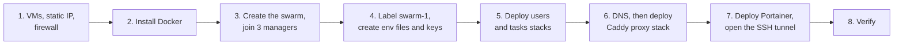
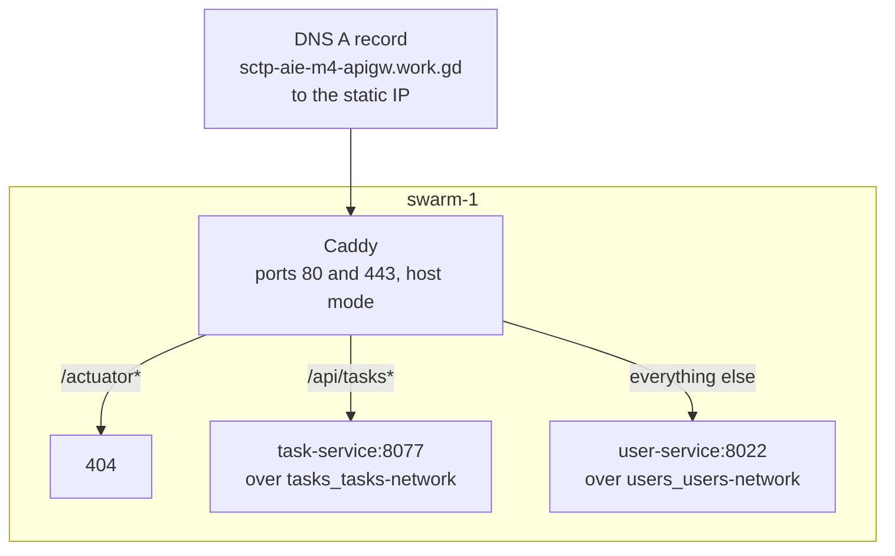

# Setup Guide: Docker Swarm, Caddy and Portainer on Google Cloud

Author: shengyu · Last updated: 2026-10-27

This guide builds the environment from nothing: three Google Cloud (GCP) VMs, a Docker Swarm, the Users and Tasks stacks, a Caddy reverse proxy with HTTPS, and a Portainer dashboard reached over an SSH tunnel. For the reasoning behind each choice see the design and motivation document.

## 1. Overview



The order matters. The proxy joins the Users and Tasks overlay networks, so those stacks must exist before it, and DNS must point at the static IP before Caddy can get a certificate.

### 1.1 Target layout

| Node | Role | Runs |
|---|---|---|
| `swarm-1` | Manager, static public IP | Caddy, `user-db`, `task-db`, app replicas, Portainer agent |
| `swarm-2` | Manager | App replicas, Portainer agent |
| `swarm-3` | Manager | App replicas, Portainer server, Portainer agent |

### 1.2 Conventions

- Names, project and zone used below: zone `asia-southeast1-b`, region `asia-southeast1`, domain `sctp-aie-m4-apigw.work.gd`. Replace them with your own.
- Commands marked **local** run in a terminal with the `gcloud` CLI (your computer or Cloud Shell). Commands marked **swarm-N** run over SSH on that VM.
- `sudo` is used for every `docker` command so you do not need to add yourself to the `docker` group.
- Passwords, JWT keys and env files never go into Git.

### 1.3 Option: create the infrastructure with Terraform

Sections 3 to 5 (VMs, static IP, firewall, Docker, swarm) can be done by Terraform instead of by hand. The Terraform project creates the three VMs, the static IP, the firewall rules and the service account, installs Docker through a startup script, and forms the swarm of three managers by itself, including the `db=true` label on `swarm-1`.

| Guide section | Manual (this guide) | With Terraform |
|---|---|---|
| 3. VMs, static IP, firewall | `gcloud` commands | Created by `terraform apply` |
| 4. Install Docker | SSH to each node | Done by the startup script |
| 5. Create the swarm, label `swarm-1` | `docker swarm init` and `join` | Done by the startup script |
| 6. Env files and JWT keys | By hand | By hand (kept out of Terraform state on purpose) |
| 7. Users and Tasks stacks | By hand or CI | By hand or CI |
| 8.1 DNS record | By hand | By hand (use the `swarm1_public_ip` output) |
| 8. Caddy, 9. Portainer | Stack files | Stack files |

```bash
gcloud auth application-default login
cp terraform.tfvars.example terraform.tfvars      # set project_id
terraform init
terraform apply
```

After `apply`, allow a few minutes for the nodes to join, check with `sudo docker node ls` on `swarm-1`, then continue from section 6. Remove the infrastructure later with `terraform destroy`.

Terraform project and its full instructions (variables, how the swarm forms, limits): [Terraform README](terraform/README-terraform.md).

Use the manual path to learn what each step does, and the Terraform path to rebuild the environment quickly and repeatably.

## 2. Prerequisites

- A GCP project with billing enabled and the Compute Engine API turned on. A new account's free trial (US$300 of credit, valid for 90 days) covers this environment; check the remaining credit and expiry date under Billing, and tear the environment down before the trial ends.
- The `gcloud` CLI signed in to that project.
- A domain name you control, so you can create an A record.
- Docker Hub images for both APIs (built by the CI pipeline).

```bash
# local
gcloud config set project <PROJECT_ID>
gcloud config set compute/zone asia-southeast1-b
gcloud services enable compute.googleapis.com
```

## 3. Create the VMs, static IP and firewall rules

### 3.1 Reserve a static IP for swarm-1

Caddy answers on `swarm-1`, and the DNS record points at its address, so the address must not change if the VM restarts.

```bash
# local
gcloud compute addresses create swarm-1-ip --region=asia-southeast1
gcloud compute addresses describe swarm-1-ip --region=asia-southeast1 --format='value(address)'
```

Note the printed address; this is the one DNS will use.

### 3.2 Create three VMs

```bash
# local
for n in swarm-1 swarm-2 swarm-3; do
  extra=""
  [ "$n" = "swarm-1" ] && extra="--address=swarm-1-ip"
  gcloud compute instances create "$n" \
    --zone=asia-southeast1-b \
    --machine-type=e2-medium \
    --image-family=ubuntu-2404-lts-amd64 --image-project=ubuntu-os-cloud \
    --boot-disk-size=30GB \
    --tags=swarm $extra
done
```

`e2-medium` gives 2 vCPU and 4 GB, which is enough for the JVM replicas (512 MB limit each), two Postgres containers (384 MB limit each) and the proxy. The `swarm` network tag is how firewall rules find these VMs.

### 3.3 Firewall rules

| Port | Source | Rule | Purpose |
|---|---|---|---|
| TCP 22 | Internet | `default-allow-ssh` | Admin, CI deploys, SSH tunnels |
| TCP 80, 443 | Internet | `swarm-web` (create below) | Caddy: HTTPS, certificate issuance, redirect |
| TCP 2377, TCP+UDP 7946, UDP 4789 | Other nodes | `default-allow-internal` | Swarm control and overlay traffic |

```bash
# local
gcloud compute firewall-rules create swarm-web \
  --direction=INGRESS --action=ALLOW --rules=tcp:80,tcp:443 \
  --source-ranges=0.0.0.0/0 --target-tags=swarm
```

On the `default` network, `default-allow-internal` already allows all traffic between VMs. If you use a custom network, create an equivalent rule for the three Swarm ports above, restricted to the subnet range.

Do not create rules for 8022, 8077, 5422, 5477 or 9443. The APIs, databases and Portainer must never be open to the internet. Port 80 must stay open, because Let's Encrypt validates the domain over it.

## 4. Install Docker on every node

SSH to each VM (`gcloud compute ssh swarm-1`) and run:

```bash
# swarm-1, swarm-2 and swarm-3
curl -fsSL https://get.docker.com | sudo sh
sudo docker version
sudo systemctl enable --now docker
```

The convenience script installs the current stable Docker Engine from Docker's repository. For a stricter setup, install from the apt repository using Docker's documented steps instead, and pin the version so the nodes stay identical.

## 5. Create the swarm

### 5.1 Initialise on swarm-1

```bash
# swarm-1
INTERNAL_IP=$(hostname -I | awk '{print $1}')
sudo docker swarm init --advertise-addr "$INTERNAL_IP"
```

Use the internal address for `--advertise-addr`, so cluster traffic stays on the private network.

### 5.2 Join swarm-2 and swarm-3 as managers

```bash
# swarm-1: print the manager join command
sudo docker swarm join-token manager
```

Copy the printed `docker swarm join --token ... <swarm-1 internal IP>:2377` command and run it with `sudo` on `swarm-2` and `swarm-3`.

All three nodes are managers on purpose. Swarm's Raft consensus needs a majority, so three managers survive the loss of one node, whereas one or two do not. Managers also run workloads here.

### 5.3 Check the cluster

```bash
# swarm-1
sudo docker node ls
```

Expect three nodes, all `Ready` and `Active`, one marked `Leader` and the other two `Reachable` under MANAGER STATUS.

### 5.4 Label swarm-1 for the databases

The database volumes are on local disk, so the databases are pinned to the node that owns the volume.

```bash
# swarm-1
sudo docker node update --label-add db=true swarm-1
sudo docker node inspect swarm-1 --format '{{ .Spec.Labels }}'
```

## 6. Configuration and secrets on swarm-1

`docker stack deploy` does not read `.env` files and does not read secrets from Git. Keep this configuration on the manager that deploys, outside any repository.

### 6.1 Generate a fresh JWT key pair

Use a new pair, never the development keys.

```bash
# swarm-1
mkdir -p ~/keys && chmod 700 ~/keys
openssl genpkey -algorithm RSA -pkeyopt rsa_keygen_bits:2048 -out ~/keys/private.pem
openssl rsa -in ~/keys/private.pem -pubout -out ~/keys/public.pem
chmod 600 ~/keys/private.pem
```

Check that the PEM format matches what the applications read (the project's `TestJwtKeys` shows the format the tests use). The stack files mount the private key only into `user-service` and the public key only into `task-service`.

### 6.2 Environment files

Create `~/users.env` and `~/tasks.env` with the names the stack files expect:

```bash
# ~/users.env
DB_NAME_ENV=<users database name>
DB_USER_ENV=<users database user>
DB_PASSWORD_ENV=<strong password>
APP_PORT_ENV=8022
JWT_EXPIRATION_MS_ENV=<token lifetime in ms>
JWT_ISSUER_ENV=<issuer>
JWT_AUDIENCE_ENV=<audience>
ADMIN_USERNAME_ENV=<admin user>
ADMIN_PASSWORD_ENV=<strong password>
JWT_PRIVATE_KEY_FILE=/home/<user>/keys/private.pem
```

```bash
# ~/tasks.env
DB_NAME_ENV=taskdb
DB_USER_ENV=<tasks database user>
DB_PASSWORD_ENV=<strong password>
APP_PORT_ENV=8077
JWT_ISSUER_ENV=<same issuer as users>
JWT_AUDIENCE_ENV=<same audience as users>
JWT_PUBLIC_KEY_FILE=/home/<user>/keys/public.pem
```

```bash
chmod 600 ~/users.env ~/tasks.env
```

The issuer and audience must be identical in both files, or the Tasks API rejects every token. Use absolute paths for the key files; a relative or nested value fails with a "not a directory" error.

## 7. Deploy the Users and Tasks stacks

Copy `stack-users.yml` and `stack-tasks.yml` from the repository to the home directory of `swarm-1` (the CI pipeline does this on every deploy). To deploy by hand, use a clean shell and the env file that belongs to the stack:

```bash
# swarm-1: users stack
exec bash
cd ~
set -a; source users.env; set +a
export IMAGE_TAG=<version>            # for example 1.0.0, or version@sha256:<digest>
sudo -E docker stack deploy --with-registry-auth -c stack-users.yml users

# swarm-1: tasks stack (new shell, so no users.env values linger)
exec bash
cd ~
set -a; source tasks.env; set +a
export IMAGE_TAG=<version>
sudo -E docker stack deploy --with-registry-auth -c stack-tasks.yml tasks
```

What the options do:

- `set -a; source ...; set +a` exports every variable in the file, because `docker stack deploy` does not read `.env` files itself.
- `-E` makes `sudo` keep those exported variables.
- `-c` names the stack file.
- The last word (`users`, `tasks`) is the stack name, which prefixes every service and network. It must match the file; a mismatch creates stray services such as `users_task-service`.
- `--with-registry-auth` passes your Docker Hub login to the other nodes so they can pull a private image.

Check the result:

```bash
sudo docker service ls
sudo docker service ps users_user-service tasks_task-service
sudo docker network ls | grep -E 'users|tasks'
```

Expect `2/2` replicas for each API, `1/1` for each database, and the networks `users_users-network` and `tasks_tasks-network`. The APIs may take up to the 90 second health-check start period to become healthy. If a replica restarts repeatedly, read `sudo docker service logs <service> --tail 50`.

## 8. Caddy reverse proxy



### 8.1 Point DNS at the static IP

The domain `sctp-aie-m4-apigw.work.gd` was obtained from [DNSExit](https://dnsexit.com/), which offers free domain names with DNS hosting. Any DNS provider works, as long as you can create an A record that points the name at the static IP. Alternatives:

| Option | Cost | Notes |
|---|---|---|
| [DuckDNS](https://www.duckdns.org/) | Free | Free subdomains of `duckdns.org` with an A record you set yourself; simple and widely used for home and lab projects |
| [FreeDNS (afraid.org)](https://freedns.afraid.org/) | Free tier | Many shared domains to choose a subdomain from; also hosts DNS for your own domain |
| [No-IP](https://www.noip.com/) | Free tier | Free hostnames that may need periodic confirmation to stay active |
| [sslip.io](https://sslip.io/) or [nip.io](https://nip.io/) | Free, no sign-up | The name encodes the IP (for example `136-85-110-254.sslip.io`), so there is nothing to register; Let's Encrypt certificates can be rate-limited because many people share the domain |
| A registered domain plus [Cloudflare DNS](https://www.cloudflare.com/) | Domain cost, free DNS | Most reliable and portable; buy a domain from any registrar (a few dollars a year) and use Cloudflare for DNS. Set the record to "DNS only" (grey cloud) while Caddy issues its certificate |

Whichever you use, check the provider's current terms: free domains can be reclaimed if unused, and free shared domains are sometimes blocked by browsers or security filters.

Create an A record for `sctp-aie-m4-apigw.work.gd` with the address from step 3.1. Wait until it resolves:

```bash
# local
dig +short sctp-aie-m4-apigw.work.gd
```

Caddy cannot obtain a certificate until this returns the static IP, and repeated failures can trigger Let's Encrypt rate limits.

### 8.2 The Caddyfile

Save as `~/Caddyfile` on `swarm-1`, next to `stack-proxy.yml`:

```
sctp-aie-m4-apigw.work.gd {
	# Never expose Actuator through the public proxy (the container health checks use localhost inside each container).
	# This must be a handle block placed BEFORE the others: handle blocks run in the order written and the first match wins.
	# (A bare "respond" line would run after them and never be reached.)
	@actuator path /actuator /actuator/*
	handle @actuator {
		respond 404
	}

	# Tasks API
	handle /api/tasks* {
		reverse_proxy task-service:8077
	}

	# Everything else (login at /auth/login, /api/users...) goes to the users API
	handle {
		reverse_proxy user-service:8022
	}
}
```

Caddy gets the Let's Encrypt certificate for the site name automatically, redirects HTTP to HTTPS, and renews the certificate before it expires.

### 8.3 The proxy stack file

`stack-proxy.yml`:

```yaml
version: "3.8"

services:
  caddy:
    image: caddy:2
    ports:
      - target: 80
        published: 80
        protocol: tcp
        mode: host
      - target: 443
        published: 443
        protocol: tcp
        mode: host
    configs:
      - source: caddyfile_v2
        target: /etc/caddy/Caddyfile
    volumes:
      - caddy_data:/data
      - caddy_config:/config
    networks:
      - users
      - tasks
    deploy:
      replicas: 1
      placement:
        constraints: [node.hostname == swarm-1]
      restart_policy:
        condition: on-failure
        delay: 5s

configs:
  caddyfile_v2:
    file: ./Caddyfile

networks:
  users:
    external: true
    name: users_users-network
  tasks:
    external: true
    name: tasks_tasks-network

volumes:
  caddy_data:
  caddy_config:
```

Notes on the choices:

- **Host-mode ports** bind 80 and 443 directly on the node that runs Caddy and keep the real client IP visible. The default ingress mode would open them on every node through the routing mesh.
- **Placement on `swarm-1`** keeps Caddy on the node whose static IP the DNS record points at, and where its certificates are stored.
- **External networks** let one proxy reach both APIs while the APIs stay isolated from each other. The names are the stack name plus the network name, so the stacks must be deployed under the names `users` and `tasks`.
- **The `caddy_data` volume** keeps certificates and the ACME account across restarts; without it every restart requests a new certificate.

### 8.4 Deploy and verify

```bash
# swarm-1
cd ~
sudo docker stack deploy -c stack-proxy.yml proxy
sudo docker service ps proxy_caddy
sudo docker service logs proxy_caddy --tail 50
```

Look for `certificate obtained successfully` in the logs. Then test from your computer; do not use `curl -k`, which skips certificate checks:

```bash
# local
curl -I  http://sctp-aie-m4-apigw.work.gd/                 # 308 redirect to https
curl -i  https://sctp-aie-m4-apigw.work.gd/api/tasks/1     # 401 JSON from the tasks API (no token)
curl -i  https://sctp-aie-m4-apigw.work.gd/actuator/health # 404 from Caddy
```

### 8.5 Changing the Caddyfile

Swarm configs are immutable, so editing the file and redeploying changes nothing. Give the config a new name each time:

1. Edit `~/Caddyfile` on `swarm-1`.
2. In `stack-proxy.yml`, rename the config in both places (`caddyfile_v2` to `caddyfile_v3`).
3. Run `sudo docker stack deploy -c stack-proxy.yml proxy`.
4. Check what was loaded: `sudo docker config inspect --pretty proxy_caddyfile_v3`.
5. Remove the old config: `sudo docker config rm proxy_caddyfile_v2`.

## 9. Portainer

### 9.1 The stack file

Portainer has two services: an agent in global mode (one per node, reading each node's Docker socket) and the server, pinned to `swarm-3` so the dashboard stays off `swarm-1`.

`stack-portainer.yml`:

```yaml
version: "3.8"

services:
  agent:
    image: portainer/agent:lts
    volumes:
      - /var/run/docker.sock:/var/run/docker.sock
      - /var/lib/docker/volumes:/var/lib/docker/volumes
    networks:
      - agent_network
    deploy:
      mode: global
      placement:
        constraints: [node.platform.os == linux]

  portainer:
    image: portainer/portainer-ce:lts
    command: -H tcp://tasks.agent:9001 --tlsskipverify
    ports:
      - target: 9443
        published: 9443
        protocol: tcp
        mode: host
    volumes:
      - portainer_data:/data
    networks:
      - agent_network
    deploy:
      replicas: 1
      placement:
        constraints: [node.hostname == swarm-3]

networks:
  agent_network:
    driver: overlay
    attachable: true

volumes:
  portainer_data:
```

This file follows Portainer's standard Swarm stack with two changes: the server is pinned to `swarm-3`, and only port 9443 is published, in host mode so it exists only on `swarm-3`. Compare it with the current file in Portainer's documentation before using it, since image tags and options change between releases.

### 9.2 Deploy

```bash
# swarm-1 (any manager)
sudo docker stack deploy -c stack-portainer.yml portainer
sudo docker service ls | grep portainer
sudo docker service ps portainer_agent portainer_portainer
```

Expect `portainer_agent` at 3/3 (global) and `portainer_portainer` at 1/1 on `swarm-3`.

### 9.3 Open it through an SSH tunnel

Port 9443 is not in the firewall, so the dashboard is only reachable through SSH. Run this **on your own computer**, the one whose browser you will use, not in Cloud Shell, where `localhost` is the Cloud Shell machine:

```bash
# local
gcloud compute ssh swarm-3 --zone=asia-southeast1-b -- -L 9443:localhost:9443
```

Leave that terminal open and browse to `https://localhost:9443`. Accept the self-signed certificate warning; the connection to the dashboard is encrypted and only reachable through the tunnel.

### 9.4 First run

Create the administrator account immediately. Portainer switches off its setup page a few minutes after the container starts if no admin exists. If you see "timed out for security purposes", restart the server and set up the account straight away:

```bash
# swarm-1
sudo docker service update --force portainer_portainer
```

If the environment list shows only one node, add the swarm through the agent: Environments, Add environment, Docker Swarm, Agent, address `tasks.agent:9001`.

### 9.5 Using it safely

- Do not open port 9443 in the firewall and do not route Portainer through Caddy. The dashboard has access to the Docker socket on every node.
- Treat it as read-mostly. A change made in the UI is replaced by the next CI deploy, which applies the stack file from Git.
- Remove it when finished: `sudo docker stack rm portainer`, then close the tunnel.

## 10. Verification checklist

| Check | Command or action | Expected |
|---|---|---|
| Three managers | `sudo docker node ls` | 3 nodes, `Ready`, one `Leader`, two `Reachable` |
| Replicas | `sudo docker service ls` | APIs `2/2`, databases `1/1`, `proxy_caddy` `1/1`, agent `3/3` |
| Placement | `sudo docker service ps users_user-db tasks_task-db proxy_caddy` | All on `swarm-1` |
| HTTPS | `curl -I https://sctp-aie-m4-apigw.work.gd/` | Valid certificate, no `-k` needed |
| Actuator hidden | `curl -i https://.../actuator/health` | 404 |
| Ports closed | `curl -m 5 http://<static IP>:8022` | Times out |
| Login path | `POST https://.../auth/login` | Reaches the users API |
| Failover | Stop `swarm-2` | Replicas restart on the other nodes within seconds |
| Dashboard | Tunnel, then `https://localhost:9443` | Portainer login page |

## 11. Troubleshooting

| Symptom | Cause | Fix |
|---|---|---|
| `invalid reference format` on deploy | `IMAGE_TAG` blank or cut off at `@sha256` | Export the full `version@sha256:<hex>`, or read it from `docker service inspect <service> --format '{{ .Spec.TaskTemplate.ContainerSpec.Image }}'` |
| `... not a directory` when creating a secret | Key path variable unset, relative or nested | Use an absolute path in the env file and source the right file |
| Stray service such as `users_task-service` | Stack deployed under the wrong name | `docker service rm` the service, then remove the stray network |
| Replicas restart repeatedly | Database not ready yet, or health check failing | Check the logs; confirm the actuator liveness endpoint is permitted in Spring Security |
| Caddy returns a certificate error | DNS wrong, port 80 closed, or rate limit | Confirm the A record and the `swarm-web` rule, then read the Caddy logs |
| `/actuator/health` returns 200 | Old config still loaded, or rule not in a `handle` block | Create a new config name (section 8.5) and inspect it |
| Caddy cannot reach an API | Caddy not on that stack's network, or stack deployed under a different name | Check the external network names in `stack-proxy.yml` |
| Tunnel connects but the page is blank | Tunnel run in Cloud Shell, or no admin created in time | Run the tunnel on your own computer; restart the Portainer server |
| `database is being accessed by other users` while renaming a database | The app is still connected | Scale the app to 0 first, rename, scale back |
| CI deploy fails with "Host key verification failed" | `SSH_KNOWN_HOSTS` or `SSH_HOST` is out of date | Refresh both with the current IP and `ssh-keyscan -t ed25519 <ip>` |

## 12. Teardown

```bash
# swarm-1
sudo docker stack rm portainer proxy tasks users

# local
gcloud compute instances delete swarm-1 swarm-2 swarm-3 --zone=asia-southeast1-b --quiet
gcloud compute firewall-rules delete swarm-web --quiet
gcloud compute addresses delete swarm-1-ip --region=asia-southeast1 --quiet
```

Release the static IP after the VM is deleted, because a reserved address that is not attached to a running VM is billed. Then check Disks and IP addresses in the console for leftovers, and remove the DNS record. Keep the stack files, the Caddyfile and the workflows in Git so the environment can be rebuilt from this guide.