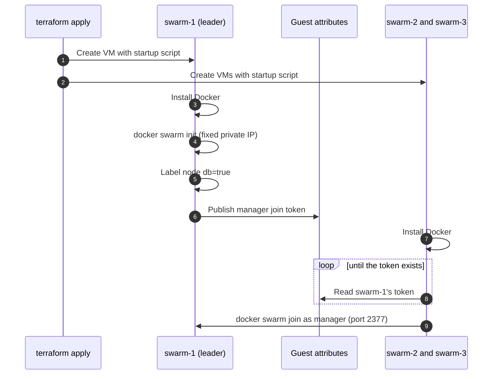

# Terraform: Docker Swarm infrastructure on GCP

Creates the Google Cloud side of the setup: three VMs, a static IP, firewall rules, and a Docker Swarm of three managers that forms itself on first boot. It does not deploy the applications; those stay in the stack files and the CI pipeline.

## What it creates

| Resource | Purpose |
|---|---|
| `google_compute_address.swarm1_public` | Static public IP for `swarm-1` (the DNS record points here) |
| `google_compute_address.swarm1_internal` | Fixed private IP the other nodes use to join |
| `google_compute_instance.node` (x3) | `swarm-1..3`, `e2-medium`, Ubuntu 24.04, tag `swarm`, shielded VM |
| `google_compute_firewall.swarm_web` | TCP 80 and 443 from the internet (Caddy) |
| `google_compute_firewall.swarm_ssh` | TCP 22 from `ssh_source_ranges` |
| `google_compute_firewall.swarm_internal` | 2377/tcp, 7946/tcp+udp, 4789/udp between swarm nodes only |
| `google_service_account.swarm_node` + `roles/compute.viewer` | Lets joining nodes read the leader's join token |

No rule opens 8022, 8077, 5422, 5477 or 9443.

## What stays outside Terraform

| Step | Where it lives |
|---|---|
| DNS A record for your domain (DNSExit is not a Terraform-supported provider) | By hand, using the `swarm1_public_ip` output |
| `users.env`, `tasks.env`, JWT keys | Created by hand on `swarm-1`, never in Git or Terraform state |
| Users, Tasks, Caddy and Portainer stacks | Stack files in Git, deployed by hand or by CI |
| Image builds and releases | GitHub Actions |

Keeping secrets and app deploys out of Terraform avoids writing passwords and keys into the state file.

## How the swarm forms



The startup script runs on every boot and is safe to repeat: it installs Docker once and does nothing if the node is already in a swarm. Progress is logged to `/var/log/swarm-bootstrap.log` on each VM.

## Usage

```bash
gcloud auth application-default login
cp terraform.tfvars.example terraform.tfvars      # set project_id
terraform init
terraform plan
terraform apply
```

Then follow the printed `next_steps`: create the DNS record, create the env files and keys on `swarm-1`, and deploy the stacks. Allow a few minutes after `apply` for Docker to install and the nodes to join, then check:

```bash
gcloud compute ssh swarm-1 --zone=asia-southeast1-b
sudo docker node ls          # 3 nodes, 1 Leader, 2 Reachable
sudo docker node inspect swarm-1 --format '{{ .Spec.Labels }}'    # map[db:true]
```

Remove everything with `terraform destroy`. The static IP is released with it, so there is no leftover charge.

## Variables

| Variable | Default | Notes |
|---|---|---|
| `project_id` | required | GCP project |
| `region`, `zone` | `asia-southeast1`, `asia-southeast1-b` | |
| `network`, `subnetwork` | `default`, `default` | Change both for a custom VPC |
| `machine_type` | `e2-medium` | 2 vCPU, 4 GB |
| `node_count` | `3` | Must be odd, so the managers keep quorum |
| `ssh_source_ranges` | `["0.0.0.0/0"]` | Narrow to your own IP when you can |
| `web_source_ranges` | `["0.0.0.0/0"]` | Port 80 must stay reachable for Let's Encrypt |

## Notes and limits

- **Not run against a real project.** The files were checked for formatting and the startup script was rendered and syntax-checked, but `terraform plan` and `apply` need your GCP credentials. Expect to fix small provider details on first run.
- **Join token.** The manager token sits in `swarm-1`'s guest attributes, readable by principals with `compute.viewer` on the project. It only matters before the nodes have joined; rotate it with `docker swarm join-token --rotate manager` afterwards.
- **Node 2 and 3 have ephemeral public IPs** so they can install packages. Only `swarm-1` has the static one.
- **Same limits as the manual setup:** databases are pinned to `swarm-1`, and Caddy is a single replica there.
- **Do not commit state.** `terraform.tfstate` and `terraform.tfvars` are in `.gitignore`. For a team, use a remote backend such as a Cloud Storage bucket.
- **Free trial:** the environment fits inside the GCP free trial credit; run `terraform destroy` before the trial ends.
